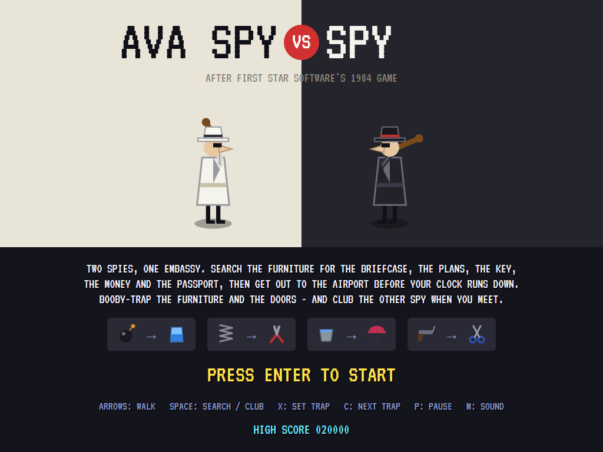
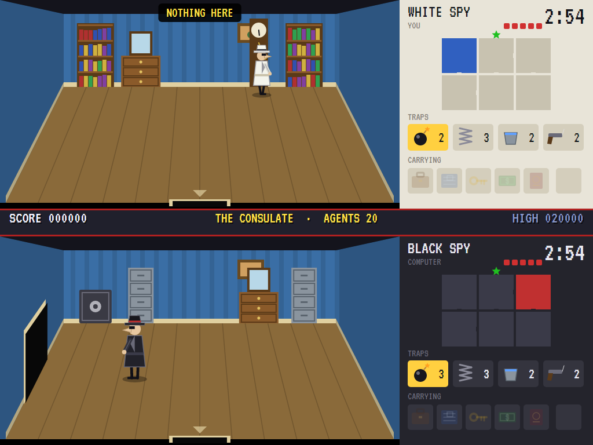
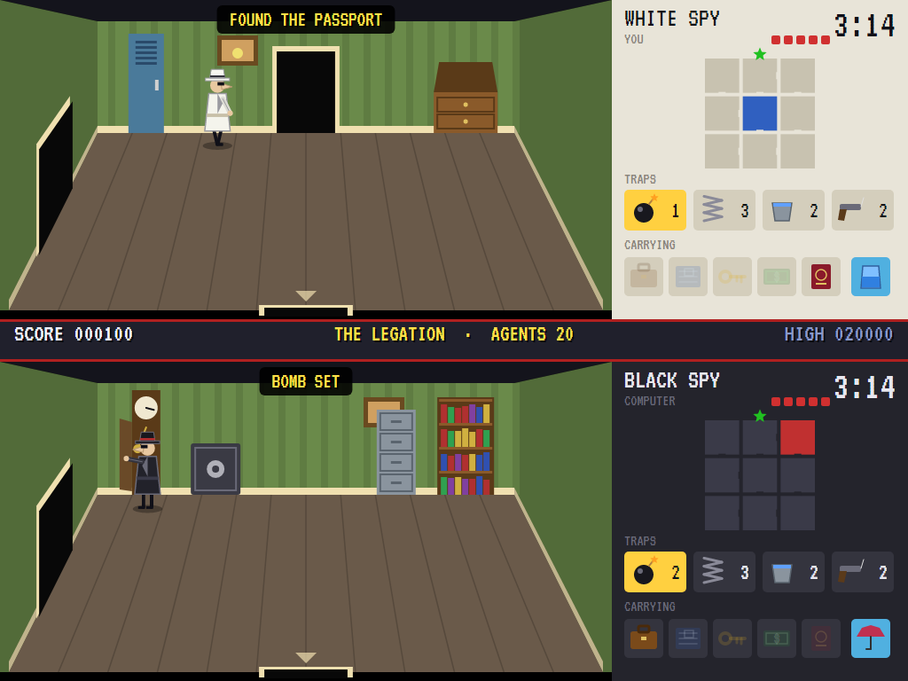
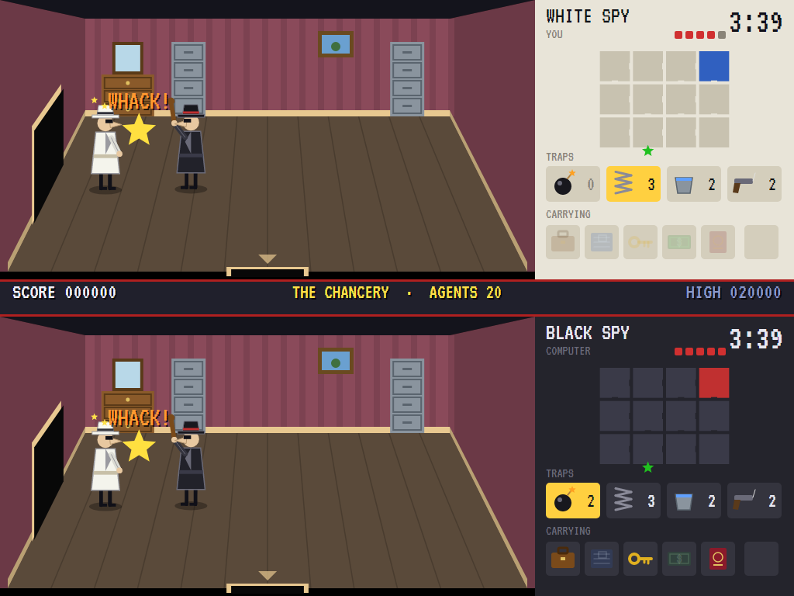
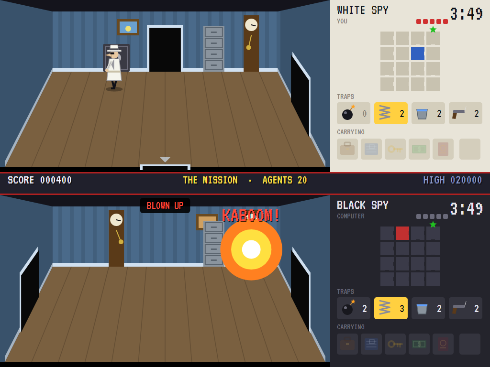
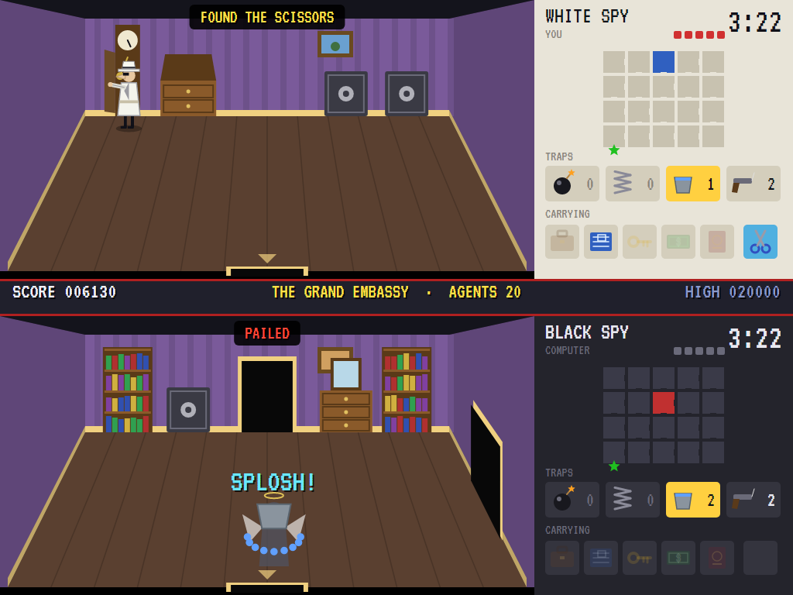
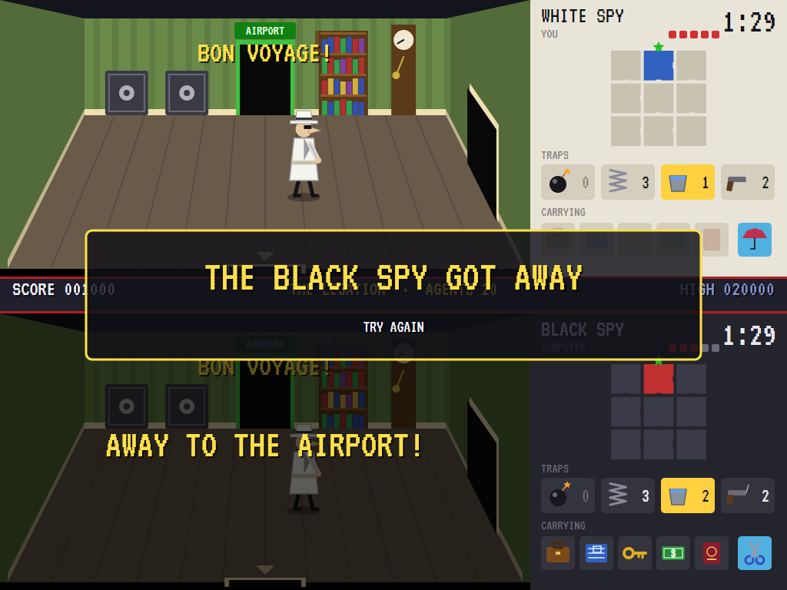
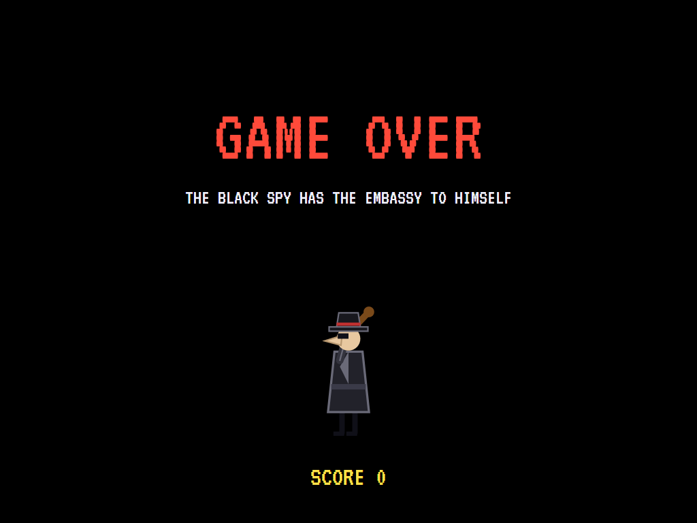
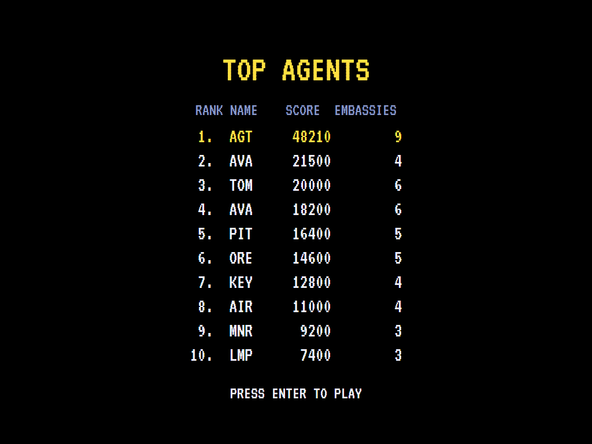

# AVA Spy vs Spy

[](https://github.com/Harlock123/AVASpyVsSpy/actions/workflows/build.yml)

A split-screen game of searching, booby-trapping and clubbing, in the style of First Star Software's 1984
home-computer game **Spy vs Spy**. It's built with .NET 10 and Avalonia UI. A white spy and a black spy are
loose in the same embassy, each against his own clock. Each wants the same five things: the briefcase, the
plans, the key, the money and the passport. They're hidden in the furniture. Find them all, then get out
through the door to the airport. The other spy is doing the same, and he leaves surprises behind him.

## Features

- **Two views at once:** your room above, the black spy's below. Each view has its own map, clock,
  trapulator and pockets, so you can see what he's up to (and he can see what you're up to).
- **Five embassies**, each larger than the last: The Consulate (6 rooms), The Legation (9), The Chancery
  (12), The Mission (16) and The Grand Embassy (20). Each is built afresh every time it's played: a maze of
  doors with more than one way round, and two to four pieces of furniture in every room. There are desks,
  filing cabinets, bookcases, dressers, safes, lockers, bureaus and grandfather clocks.
- **Search** any piece of furniture. The five things and four remedies are hidden once each, never in the
  rooms the spies start in. A spy carries all five things, but only one remedy at a time.
- **The trapulator:** three bombs and three springs to hide in furniture, and two pails of water and two
  guns on strings to set over doors. Whoever opens the furniture or goes through the door gets it, setter
  included.
- **The remedies:** water puts out a bomb, cutters cut a spring, an umbrella keeps off a pail, and scissors
  snip a gun's string. With the right one in hand, a trap is sprung harmlessly.
- **Fights:** when the spies meet, they club each other. Five blows and a spy is done for.
- **Dying** costs time: a spy's ghost floats up, and he's back six seconds later somewhere else. Whatever he
  carried is hidden again in the furniture of the room where he fell.
- **The way out** only opens for a spy with all five things. Get away first and the seconds left on your
  clock are points. If the black spy gets away first, or your clock runs out, it's the same embassy again,
  one agent down.
- **The computer spy** knows the embassy's plan but not what's hidden where. It searches the nearest
  furniture first and remembers what it has found empty. When someone dies in a room, it forgets that room's
  furniture. It keeps clear of its own traps and any it saw you set. It leaves traps of its own, fights
  when you meet, and comes after you when you have what it needs and there's nothing left to search. It
  gets sharper with each embassy. The attract mode is two computer spies at it.

## Screenshots

| The title | The embassy | Searching |
|:---------:|:-----------:|:---------:|
|  |  |  |
| The traps, and what gets you through them. | Two spies, two views. | A drawer opened. |

| A fight | A bomb | A pail over the door |
|:-------:|:------:|:--------------------:|
|  |  |  |
| Clubs out. | Kaboom. | Splosh. |

| Away | Game over | The top agents |
|:----:|:---------:|:--------------:|
|  |  |  |
| Through the door to the airport. | The black spy wins. | The high-score table. |

The screenshots are made by the tests, which play the game in a real (headless) window; see
[Tests](#tests).

## Download and run

Ready-to-run builds for Windows, macOS and Linux, on both Intel/AMD and ARM, are on the
[Releases page](https://github.com/Harlock123/AVASpyVsSpy/releases/tag/latest). **Latest build** is
rebuilt on every push to `main`. Each download is one self-contained executable: no .NET install is
needed.

| Platform | Archive |
|---|---|
| Windows | `AVASpyVsSpy-win-x64.zip`, `AVASpyVsSpy-win-x86.zip`, `AVASpyVsSpy-win-arm64.zip` |
| macOS | `AVASpyVsSpy-osx-arm64.tar.gz` (Apple silicon), `AVASpyVsSpy-osx-x64.tar.gz` (Intel) |
| Linux | `AVASpyVsSpy-linux-x64.tar.gz`, `AVASpyVsSpy-linux-arm64.tar.gz`, `AVASpyVsSpy-linux-arm.tar.gz` |

```bash
tar -xzf AVASpyVsSpy-linux-x64.tar.gz     # or linux-arm64, linux-arm, osx-arm64, osx-x64
./AVASpyVsSpy
```

On Windows, unzip and run `AVASpyVsSpy.exe`. On macOS, if Gatekeeper refuses to open it, run
`xattr -d com.apple.quarantine AVASpyVsSpy` once. Run with `--no-audio` for silence.

**Sound** comes through OpenAL Soft, built in for every platform. In a virtual machine the game
detects it and uses a larger audio buffer, so the sound doesn't break up.

**Gamepads** use SDL2, which is bundled for Windows, macOS and Intel/AMD Linux. ARM Linux builds need it
installed; without it the keyboard still works:

```bash
sudo apt install libsdl2-dev            # Debian / Ubuntu / Raspberry Pi OS
sudo pacman -S --needed sdl2-compat     # Arch / Omarchy
```

## Controls

| Action | Keyboard | Gamepad |
|---|---|---|
| Start | Enter or 1 | Start |
| Walk (up is towards the back wall) | Arrows or W/A/S/D | Left stick / D-pad |
| Search furniture, or swing the club | Space, Z or Ctrl | A |
| Set the chosen trap | X or Shift | B |
| Choose the next trap | C or Tab | Y or a shoulder button |
| Pause | P or Esc | Start or Back |
| Sound on/off | M | |
| Screenshot | Ctrl+S (to your Pictures folder) | |

Walk into a door to go through it. On the high-score table, type your initials, or use up/down and
Space, then Enter.

## Tests

```bash
dotnet test AVASpyVsSpy.slnx
```

The game runs in fixed 60 Hz steps, so it plays the same at any frame rate. The tests check:

- **The embassies:** every room can be reached, doors match on both sides, and the way out is on an
  outside wall. There are two to four pieces of furniture in every room, and each embassy is larger, with
  more time, than the one before. The five things and four remedies are hidden once each, away from the
  starts. The two computer spies play every embassy out, and one of them gets away. A player who does
  nothing loses every embassy to the black spy.
- **Walking:** through a door into the next room; a wall without a door; up the screen towards the back
  wall.
- **Searching:** finding what's hidden; the club swung away from furniture; one remedy at a time, the old
  one left behind.
- **Traps:** a bomb in furniture, and water putting it out; a pail and a gun over a door, and the umbrella
  and scissors; setting a trap and springing it yourself; door traps over doors and furniture traps in
  furniture; choosing skips traps used up.
- **Fights:** five blows and what he carried hidden in the room; a blow knocking him back and stunning
  him; a dead spy back after a while, somewhere else.
- **The game:** the way out needs all five; the clock running out; getting away and the next embassy;
  the black spy getting away and the same embassy again; the last agent lost, then the high-score table;
  the demonstration; pause; the keys, through to the spy; the low-clock warning.

`tests/AVASpyVsSpy.Tests/PilotProbe.cs` reports how two computer spies get on against each other in each
embassy over a dozen games, for tuning (`SPY_PROBE=1`; `SPY_PROBE=lazy` for a white spy who does nothing).

The screenshot tests draw the real screen in a headless window. To refresh the README's pictures:

```bash
SPY_SHOTS=$PWD/Images dotnet test tests/AVASpyVsSpy.Tests --filter ScreenshotTests
```

## Building

```bash
dotnet build AVASpyVsSpy.slnx
dotnet run --project src/AVASpyVsSpy
```

Needs the .NET 10 SDK. The sounds and tunes are made by `tools/make_sounds.py` (standard-library Python):
`python3 tools/make_sounds.py` rewrites `src/AVASpyVsSpy/Sounds`.

## Project structure

```
AVASpyVsSpy/
├── AVASpyVsSpy.slnx
├── src/AVASpyVsSpy/
│   ├── Engine/
│   │   ├── GameEngine.cs        # States, agents, embassies in turn, the result, the title and demonstration
│   │   ├── Sim.cs               # The embassy step by step: walking, doors, searching, traps, clubs, the way out
│   │   ├── World.cs             # The spies, what's hidden where, the traps set
│   │   ├── Embassy.cs           # Rooms, doors, furniture, how an embassy is built, and the five embassies
│   │   ├── Pilot.cs             # The computer spy (the opponent, the demonstration, and the tests)
│   │   ├── HighScoreTable.cs, InitialsEntry.cs
│   │   ├── InputHandler.cs, ControllerManager.cs  # Keys and an SDL2 gamepad
│   │   └── SoundManager.cs      # Effects and tunes through OpenAL
│   ├── Audio/                   # The OpenAL engine (from the author's AVABand)
│   ├── Views/                   # The drawing: the two views, rooms, furniture, spies, traps, the panels
│   └── Sounds/                  # The synthesised effects and tunes
├── tests/AVASpyVsSpy.Tests/     # Embassy, gameplay and screenshot tests
├── tools/make_sounds.py
└── Images/                      # Screenshots
```

## About and licence

AVA Spy vs Spy © 2026 Lonnie Watson, under the [MIT License](LICENSE).

*Spy vs Spy* the game © 1984 First Star Software; *Spy vs. Spy* the comic strip, created by Antonio Prohías,
© E.C. Publications (MAD Magazine). The names belong to their owners. AVA Spy vs Spy is an independent,
unofficial game in the style of the computer game. Its spies, embassies, graphics, sounds, tunes and code
are its own; nothing is taken from the original game's program, graphics or sound, or from the comic's
artwork. It is not affiliated with or endorsed by any rights holder.
